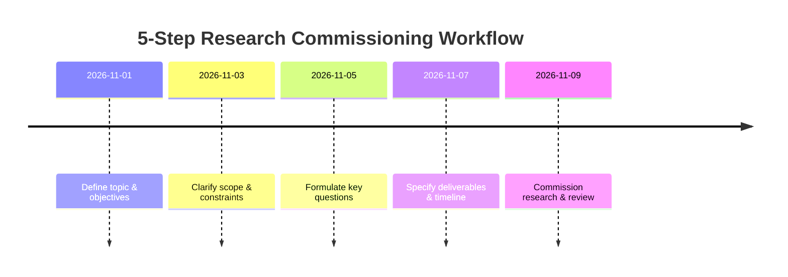

# Parampara Art Gallery – Site Structure and Content

**Overview:** Parampara will be an elegant online art gallery showcasing traditional Indian paintings, where users can browse, learn about each art form, and purchase or commission work. The site’s design and content should highlight the artwork itself, reflect India’s artistic heritage, and guide the user through a smooth shopping experience. We should use the cream-and-red color palette subtly – e.g. cream or ivory backgrounds with muted red accents and clean black/white text – to evoke warmth and tradition without sacrificing readability or contrast. The font should feel classical (perhaps a serif or calligraphic style) but remain highly legible. All page layouts should be uncluttered so each painting “takes center stage,” as experts recommend for gallery sites. The branding (logo, motifs, icons) should incorporate Indian patterns or traditional art flourishes in a restrained way, reinforcing the “Parampara” (tradition) theme.

All images of artwork must have descriptive alt text (including artist name, art form, subject) to improve SEO and accessibility. For example, an alt text might read “Madhubani painting of Radha-Krishna by Lalita Devi.” Every page (especially the homepage, category pages, and product pages) should include unique, relevant text (at least ~250 words) describing the art, as this boosts search visibility. Brief introductory copy on each page should naturally include keywords like the art form name, artist name, and “Parampara.”

Throughout the site, follow UX best practices: ensure the design is **mobile-responsive**, with thumb-friendly controls and collapsible menus on small screens (since many users browse on phone). Use subtle animations and feedback wisely – for example, the initial loader screen can animate gently, but should be brief and unobtrusive. Interactive elements (buttons, menus, modals) should have smooth, clear transitions so users always know what state the site is in.

## Loader Screen (“Welcome” Animation)

- **Content:** In the center, display the word “Welcome” in multiple major Indian languages (e.g. “नमस्ते” in Hindi, “স্বাগতম” in Bengali, “வரவேற்பு” in Tamil, “સ્વાગત” in Gujarati, “స్వాగతం” in Telugu, "ನಮಸ್ಕಾರ" in kannada etc.), cycling every few seconds. This emphasizes cultural richness. Below, at the bottom center, show the site title “Parampara” in stylized text.
- **Design:** Use a cream background with very subtle traditional-pattern motifs (like faint mandala outlines or textile patterns) that move or fade in a slow loop. The animations should be gentle (e.g. a slow parallax or shimmer) so they’re not distracting. Make the cycle quick – ideally under 5–8 seconds total – and allow skipping or quick load if the user proceeds. The welcome text itself can fade or slide; keep it elegant and not too flashy.
- **Purpose:** The loader sets the tone (celebratory, heritage-focused) but should _not_ delay the user long. It communicates “Parampara is about Indian art” immediately, before the main site appears.

## Navigation Bar (Header)

The top navbar should be clean and intuitive:

- **Logo/Home:** Left side – the Parampara logo (or text logo) links to the Home page.
- **Main Links:** Use a horizontal menu (on desktop) with items like **Home**, **Art Forms**, **About Us**, and **Contact**. “Art Forms” could open a dropdown or mega-menu listing the different categories (Madhubani, Warli, etc.), or link to a general page explaining the types (see below).
- **Search:** Include a search input (or icon) in the header. Placeholder text like “Search paintings or artists…” encourages users to find specific works. Consider live suggestions (autocomplete) of popular art titles or artists as they type. A useful tip is to pre-populate the search box with trending queries or categories.
- **Account:** On the right side, an account icon or text that shows “Sign In / Sign Up” (or “Hello, [Name]” if logged in). This links to the user’s account/dashboard. Under this menu, provide links to **Profile**, **Orders**, **Addresses**, and **Logout**. According to UX research, an account dashboard should have direct links to orders, addresses, payment methods, etc..
- **Cart & Wishlist:** Next to the account, always show a **Cart icon** (with an item count badge). Baymard UX says the cart link should be prominently in the upper-right – make it stand out (for example, a red cart icon on cream) and not buried under text. Also include a **Wishlist** (“Add to List”) icon, maybe a heart, so users can save favorites.
- **Mobile Menu:** On small screens, collapse the menu into a hamburger icon. When tapped, a sidebar or dropdown should open listing all the links and categories. Ensure the menu is scrollable if long. The account and cart icons should still remain visible at the top bar even on mobile.

Overall, the navbar provides obvious entry points: logo to Home, search bar, category links (“Shop by Art Form”), user account, and cart. It should always be visible (sticky) as the user scrolls, so they can jump to a new section or their cart quickly.

## Home Page

The Home page is the emotional and navigational hub. New visitors should immediately see **where to go** and what’s special. Key sections:

- **Hero Carousel (Top Banner):** A full-width slider showcasing 3–5 featured paintings on rotation (auto-play with manual controls). Each slide shows a large image of a painting (use images with varied aspect ratios for interest). Overlay a short caption or title (e.g. artwork name and artist) at the bottom or side, and a button “Shop Now” or “Learn More” linking to that painting or its art form. Under the slider, display a brief tagline like _“Discover the beauty of India’s traditional art”_. This hero area immediately draws attention to the artwork. (Baymard research suggests using multiple images per product – our “product” here is a painting – and our carousel essentially does that.)
- **Featured Artwork Blurb:** Below the carousel, you could dynamically show a short description of whichever painting is visible (or one highlighted piece). For example: _“This week’s highlight: ‘Dharti Aakash’ – a vibrant Madhubani painting by artist X, depicting folk motifs. Learn more about Madhubani art or add this piece to your collection.”_ This reinforces content and helps SEO.
- **Explore Art Forms:** A section with a clean header like “Explore by Art Form” or “Our Traditional Art Forms.” Show maybe 4–6 art form categories as cards or tiles (e.g. Madhubani, Warli, Pattachitra, Kalamkari, etc.). Each card has a representative image or icon, the name, and a short description (one line). On hover/click, it takes the user to that art form’s page. This lets users jump directly into the style that interests them. (Even without coding details, you could use NextJS pages for each form.)
- **New Arrivals / Trending Carousels:** Below, include two horizontal carousels or grids: one for **New Arrivals** (recent additions) and one for **Trending Paintings** (best-sellers or popular). Each carousel item shows a thumbnail of the painting plus title, price, and a quick “Add to Cart” or “View” button. Keep the layout consistent with product cards (see below). These sections entice browsing and reflect the site’s inventory. Baymard suggests having “Newest” sort options and a carousel of products (our carousels serve that function).
- **Callout Banner:** Optionally, insert a full-width promotional banner or image block. For example, a static image (or mild animation) with text overlay: _“Handcrafted from tradition – Every painting is made to order.”_ and a CTA like “Learn About Our Process”. This breaks up the layout and reinforces brand story or a special announcement (e.g. a festival sale).
- **Footer:** The page ends with the site footer (see Footer section below).

The Home page microcopy should be welcoming and inspirational. For example: “Welcome to Parampara – where age-old Indian art meets your walls. Browse our curated collection of Madhubani, Warli, and other folk paintings. Each piece is handcrafted by skilled artisans using traditional materials.” Use friendly CTAs like “Shop Now,” “Discover More,” or “Learn About [Art Form].” Keep paragraphs short and use bullet points for key highlights (“Authentic • Hand-painted • Unique”).

## Art Form (Category) Page

When a user clicks an art form (e.g. “Madhubani”), they see a dedicated page about that style plus all products in it.

- **Header Banner:** Top of page has a banner image (maybe a scenic photo or pattern related to the art form) with a title like _“Madhubani Paintings”_. Include a subtitle or tagline: e.g. “Folk art from Bihar, known for vibrant geometric patterns and mythological themes.” This sets context.
- **Art Form Overview:** Below the banner, include a **description section**. Write a few paragraphs about the art form’s history, distinctive features, and materials (e.g. natural dyes, cotton canvas, bamboo brushes). Bullet lists can highlight materials and themes. Example content: _“Originating in the Mithila region of Bihar, Madhubani art traditionally depicts Hindu deities and nature. Artists use handmade paper and organic pigments, filling every space with intricate motifs.”_ Mention any well-known artists or awards if relevant. This educates visitors (and improves SEO by adding rich text).
- **Product Gallery:** Next comes a grid of product “cards” for that art form. Arrange them 3–4 per row (depending on screen width). Each card shows:
- A good photo of the painting (with the label included in alt text).
- Title of the piece.
- Artist name (subtly under title or on hover).
- Price: show original price, discounted price in bold, and a small badge with discount %. E.g. ₹5,000 ~~₹6,000~~ (‑17%). Highlight sale badges (red “Sale” tag) on cards that have discounts.
- **View / Details CTA:** A button or link “View Details” that goes to the product page. (Optionally, one could have “Add to Cart” here, but to keep it simple and consistent, just link to the product page for customization.)
- If desired, an “Add to Wishlist” heart icon on each card.
- Arrange the text on the card so that item name, artist, and prices are visually distinct (using font weight or color). Baymard’s research recommends making these elements stand out and separate.
- **Sorting/Filtering (optional):** If there are many products, allow sorting (Price, Newest) and filtering (on-sale, size) at the top of this section. Having a “Sale” filter is a known UX best practice. Provide checkboxes or drop-downs.
- **“Explore Other Forms” Carousel:** After the products grid, include a carousel or section titled **“Explore Other Art Forms”**. Show a few representative images (or cards) of different art styles (e.g. a Warli pattern, a Kalamkari motif, etc.), each linking to that category page. This helps users navigate to other styles easily.
- **Custom Banner:** Optionally include another full-width banner relevant to this art form (for example, a craftsperson working on this art) with a short caption _“From the heart of [region], hand-painted for you.”_
- **Footer:** End with the common site footer.

The key here is content: explain _what makes this art form unique_. Describe typical subjects, historical era, region, and techniques. For instance, _“Warli art (from Maharashtra) uses white paint on mud walls to depict daily life with simple geometric figures”_. This educates and sells the story behind the paintings.

## Product Page (Painting Details)

Each painting has its own page showing all details, customization, and purchasing options:

- **Breadcrumbs:** (Technical detail) Show navigation like “Home / Madhubani / [Painting Title]” at top, so users know where they are.
- **Image Gallery:** On the left (or top on mobile), show multiple photos of the painting. Include at least 3–5 images (Baymard recommends 3–5 images per product): e.g. full view, close-ups of detail, different angles. Make images zoomable (hover or click to enlarge). Clicking any image opens a modal/lightbox with high-res view and a close button, for inspection. Ensure thumbnail navigation or arrows for the gallery.
- **Title and Artist:** Next to or below the gallery, display the painting’s title in large font, and beneath it _“by [Artist Name]”_ (artist attribution adds authenticity). Also show “Category: Madhubani painting” as a label or link.
- **Pricing:** Prominently show the price details: if there’s a discount, show original price struck out, the new price, and a red badge “-X%”. If no discount, simply show _“Price: ₹X”_. Explain any deposit requirement here (e.g. “15% deposit required to order”).
- **Primary CTA – Add to Cart:** A big standout button “Add to Cart” (or “Reserve Artwork”). Baymard advises making the Add-to-Cart button uniquely styled so it stands out. Use a solid, contrasting color (deep red or black on cream) with ample whitespace around it. This should be the dominant call-to-action.
- **Secondary CTA – Customize:** Beside it, a secondary button “Customize” (lighter styling) that expands a customization form below (see below).
- **Additional Actions:** Below or near the buttons, include smaller links/icons for “Add to Wishlist” (heart) and “Share” (social icons or a modal with share links for WhatsApp, Facebook, Pinterest, etc.). Also show “Item in stock: 1” or “Ready to ship” if relevant.
- **Customization Options:** If the user clicks “Customize” (or if this panel is always visible), display configuration fields. For example:
- **Size:** radio buttons or dropdown for sizes (e.g. Small, Medium, Large) or a custom dimension input. Adjust price if needed.
- **Frame:** checkbox “Include Wooden Frame (extra ₹500)”.
- **Paper Type:** options for canvas, handmade paper, etc.
- **Additional Motifs:** any optional extras the user can request.
- **Special Instructions:** a text area labeled “Special instructions / notes” where user can describe exactly how they want the painting (colors, elements, date, etc.).  
  Explain that **“Custom orders take [X] weeks to complete.”** and the extra deposit applies if customization is selected. All chosen options should be reflected in the price. (UX tip: don’t let the user proceed without filling necessary fields or cause confusion. Use form labels and placeholders clearly.)
- **Specifications & Description Tabs:** Below that, have two tabs or accordion sections: **“Details”** and **“Customization”**. In _Details_, list key specs like dimensions, medium, shipping weight, etc. In _Description_, put the product description/story of the piece. Write this descriptively: e.g. _“This painting, _‘Rainy Day in Mumbai’_, captures the monsoon spirit in a vivid Warli style. Painted on textured canvas, it features [description of scene].”_ Include the backstory if any. After the description, include a CTA link: _“Learn more about Warli art”_ that goes back to the Warli art form page. This cross-linking helps users explore.
- **Related & “Also Viewed” Carousels:** Under the tabs, add two horizontal carousels:
- **Related Paintings:** Titled “You might also like” or “Similar Paintings.” Show other paintings from the _same art form or by the same artist_.
- **Customers Also Viewed:** Titled that way or “Recently Viewed/Popular” – show assorted items from other forms. Providing both kinds of suggestions (complementary and similar) helps engagement. The Smashing Magazine study notes that users appreciate seeing add-ons and alternatives in product pages.
- **Static Promotional Banner:** Optionally, include one more wide image banner, perhaps a lifestyle shot (“Your living room with Parampara art”) or a tagline like _“Make it Your Own: Custom commissions welcome”_.
- **Footer:** Finally, page footer.

Throughout the Product page, microcopy should be friendly and reassuring. For example, the “Add to Cart” button might say “Add to Cart – ₹X” so it’s clear. The customization instructions can say “Our artists will review your notes and contact you if needed.” Use collapsible FAQs at the bottom: e.g. “How long will delivery take?”, “What is your return policy?”, etc. (Baymard says returning policy should be clear.) Also emphasize “Secure payment” near checkout button and show accepted payment logos.

## Cart Page

When the user clicks **Cart**, they go to the cart summary:

- **Empty Cart State:** If no items, show a friendly message: “Your cart is empty” with an illustration (optional) and a prominent button “Browse Paintings” linking back to Home or categories. This prevents dead-ends.
- **Items in Cart:** If there are items, list each product as a row:
- Thumbnail image.
- Title and Art Form (link back to product).
- Artist name.
- Brief specs (e.g. Size, Frame option, if customized).
- Unit price and subtotal for that item.
- Quantity selector (see UX below).
- Actions: small links for “Save for Later” (move to wishlist), “Remove”. (“Save for Later” keeps the item but moves it out of cart; “Wishlist” adds to favorites; both are useful).
- **Quantity Control:** Use a numeric input field with adjacent +/– buttons. As Baymard found, allowing users to click + or – **and** enter a number avoids errors. Make sure the default is correct (e.g. “1” should be selected so adding another becomes “2”, not “21”!).
- **Cart Summary Sidebar:** On the right (or below on mobile), show the order summary:
- **Subtotal:** sum of items.
- **Shipping:** a dropdown to select shipping method (see note below). Or a field to enter Zip/pincode for estimate. We know delivery is by hand, but we can still calculate a fee or say “Local delivery included”.
- **Total:** final amount (item + shipping).
- **Checkout Button:** a large button “Proceed to Checkout” or “Pay Deposit & Checkout”. Indicate that only 15% payment is due now (e.g. label it “Pay 15% Deposit ₹X”).
- Optionally, a note: “Not ready to buy? You can call us at [phone] to ask questions before checkout.” (This covers the user’s desire to have a call option.)
- **Additional Links:** Below or above, “Continue Shopping” link, and small text “Have a promo code?” (if we support coupons). Show accepted payment icons (Visa, UPI, etc.) near the checkout button for trust.

On this page, cite Baymard’s advice: make “Checkout” very clear and avoid distractions. If any field is required (like zipcode), label it clearly. Ensure the design is responsive; on mobile, stack the summary below or hide it in a toggle.

## Checkout & Authentication

- **Login/Signup:** If a user tries to checkout and isn’t logged in, prompt them to log in or sign up. Offer a **Guest Checkout** option prominently (Baymard notes making guest checkout obvious is best practice). Use simple forms: name, email, password or signup with OTP. (Since the site will handle orders, capturing email/phone is key.) Minimize friction in these forms (no overly complex password rules). Once signed in, preserve the cart contents.
- **Checkout Form:** Collect shipping details (Name, Address, City, State, PIN code, Phone) and billing if needed. If delivery is always by hand, you might simply ask for address and tell them a representative will confirm delivery time. If multiple fulfillment methods exist, list them (e.g. “Home Delivery”, “In-Store Pickup”) so the user can pick, though it sounds like delivery is standard here.
- **Payment:** Show the deposit amount (15% of order total) and the remaining “Pay on delivery” note. Let user choose payment method for the deposit: e.g. Credit Card/UPI/Netbanking/Wallet. After paying 15%, prompt the user to fill in the **Order Confirmation Form** on-site (or automatically populate it) with payment reference details, so they have a record. Provide a “Download Receipt” button (PDF) and email the order summary. Clearly explain the terms: e.g. “Your painting order is confirmed. We will start working on it upon receiving the 15% deposit. The remaining balance can be paid when the painting is delivered.”
- **Confirmation:** After checkout, show an order confirmation page: “Thank you for your order! Order #[12345] has been created.” Include order details, expected timeline (“Expected delivery: 4–6 weeks”), and contact info (“Need help? Contact us anytime”). Send a confirmation email with all this.

## User Account & Profile

In the user’s account dashboard (after login), include:

- **Dashboard Home:** Greet user (e.g. “Welcome, Priya!”). Show a summary: “You have X past orders.”
- **My Orders:** A page listing all orders with statuses (“Pending Deposit”, “In Production”, “Shipped”, etc.). Each order has a “View Details” to see items and their customization. Users can click “Reorder” if they want another copy.
- **Personal Info:** A section for user’s name, email, phone, and saved addresses (for quick checkout). Allow editing these easily.
- **Payment Methods:** If we allow saved cards or UPI IDs, let them manage these (with a fake “edit” that actually deletes and re-adds).
- **Wishlist (“Saved Paintings”):** List of items the user added to their “Add to List”. From here they can move items to cart.
- **Possibly** Preferences: Newsletter sign-up.
- **Support/Help:** A link or contact info for customer service.
- **Security:** Include a Logout button.

Keep the account interface simple. Baymard emphasizes direct links to key features. For example, the dashboard could have tiles or menu for “Orders”, “Saved Addresses”, “Account Settings”, “Support”.

## Footer

Every page should end with a footer containing relevant links and info:

- **About Us:** Link to an About page (story of Parampara, mission).
- **Contact Us:** Link to a Contact page or show email/phone. (You might also embed a simple contact form and map if there’s a physical studio.)
- **Links:** Quick links to pages like Home, Art Forms, FAQs, Shipping & Returns (this should clearly explain deposit and refund policy), Privacy Policy, Terms of Service.
- **Social Media:** Icons linking to Parampara’s social pages (Instagram, Facebook, etc.) for marketing. Label them clearly. If there’s an Instagram gallery, you could embed a feed snippet.
- **Newsletter Signup:** A short form (“Stay updated on new art & offers”) with an email input.
- **Legal:** Copyright notice.
- **Colors:** This footer can have a slightly darker background (e.g. muted red or dark cream) for contrast. Use white or black text as needed.

## Additional Features & Flows

- **Search Functionality:** The search bar should allow users to find paintings by title, artist, or keywords (like “lotus”, “elephant”, etc.). Show results as product cards. Suggest keywords as they type (e.g. “Search by artist or art form…”).
- **Filters:** On category pages, provide filters (by price range, by discount, or by substyle). Use checkboxes (Baymard suggests visible checkbox filters are effective).
- **Wishlist (“Add to List”):** Users can “save” items for later. Make it easy from any page (product, category) to add to wishlist. Their wishlist should sync to account, and also have an “Add All to Cart” button.
- **Social Sharing:** Let users share product pages with social/share buttons. Microcopy like “Share this artwork” or icons of share.
- **User Reviews/Testimonials:** Although not mentioned, consider allowing brief testimonials on product pages or a review after purchase (this can build trust). If not ratings, even “Customer comments” could be nice.
- **Custom Commission Info:** If you offer fully custom art (beyond just customizing existing pieces), consider a section explaining “Commission Your Own Painting” where users can request a fully custom piece.
- **Help/FAQ:** A dedicated FAQ section (or at least FAQ entries on relevant pages) answering common questions: payment options, deposit policy, delivery, returns (though likely no returns on art).
- **Multilingual/Localization:** While the site is in English (en-IN), you could consider future support for Hindi or other languages. For now, ensure all static text is in clear, friendly English (Indian usage). If multiple currencies or international customers, show INR by default, maybe with a country selector.
- **Accessibility:** Follow WCAG guidelines. Make sure the red-on-cream color combination meets contrast (test with WCAG tools; if it fails, adjust red to a darker shade). Avoid conveying information by color alone (e.g. don’t just say “price in red means sale” without a label). Provide keyboard access (tab through links, close modal with Esc). All images have alt text. Use clear headings and labels on forms. Provide skip-to-content link if helpful.
- **Loading & Performance:** Lazy-load images and use low-res placeholders so pages load quickly. Although we have a loader screen, the site should still be snappy. Users can lose patience if loading is slow. Provide a progress indicator if any step (like payment) takes time.

## Branding & Tone

- **Voice & Tone:** Write in a warm, respectful tone that celebrates tradition. Use second person (“you”) sparingly – more likely use inclusive language: _“Our collection showcases… Each painting is made to order for you.”_ Be proud but not boastful.
- **Microcopy Examples:**
- CTAs: “Browse Collection,” “Add to Cart,” “Customize Yours,” “Learn More,” “Proceed to Checkout,” “Save for Later.”
- Buttons: make primary buttons (Add to Cart, Checkout) action-oriented and in active voice.
- Form prompts: e.g. “Enter your full address,” “Special instructions for your painting.”
- Alerts: e.g. “Added to your cart!” or “Please enter a valid PIN code.”
- Loader text: “स्वागतम्! / স্বাগতম! / स्वागत हैं!” (Hindi / Bengali / Hindi alternatives with “Welcome!”) cycling in a subtle animation loop.
- Error messages should be gentle: e.g. “Oops, that ZIP code looks off. Please check.”
- **Cultural Sensitivity:** Since this is Indian art, ensure respectful representation of cultural symbols. Any religious imagery should be handled tastefully. Captions can include a bit of context (e.g. _“Krishna’s flute symbolizes divine love”_).
- **Images:** Use only images you have rights to (user said “I have a few paintings”). Ensure they are high-quality. You can still overlay a light watermark (like a tiny Parampara logo) at a corner to prevent unauthorized use, but make it subtle.

## Accessibility & Internationalization

- **Contrast & Colors:** As noted, check that red and cream contrast meets WCAG AA (4.5:1) if red text is on cream background. If not, use black for body text and reserve red for headings or highlights.
- **Screen Readers:** Use semantic HTML (e.g. `<button>`, `<nav>`, `<main>`) and ARIA roles for dynamic parts (like the image carousel).
- **Keyboard:** All interactive elements (hamburger menu, sliders, modals) should be keyboard-accessible. Include a focus state style.
- **Localization:** The site is in English, but since it caters to Indian audience, consider a toggle to Hindi or other major Indian languages in the future. At minimum, display numbers and dates in a format familiar to Indian users. For example, price format “₹5,000” with comma as per Indian numbering.

## Summary of Key Pages & Features

- **Loader:** Artistic welcome animation with “Welcome” in Indian languages, Parampara logo.
- **Navbar:** Logo, Home, Art Forms menu, Search bar, Account login, Cart icon (with badge), Wishlist icon, and mobile hamburger.
- **Home:** Hero image slider of paintings, tagline, “Explore Art Forms” section, New Arrivals carousel, Trending carousel, promotional banners, footer.
- **Art Form Pages:** Hero banner for the art style, text about history/materials, product grid (cards with image, name, price, artist), “Explore Other Forms” carousel, footer.
- **Product Page:** Image gallery (3–5 images), title/artist/category, price and discount, **Add to Cart** (prominent) and **Customize** buttons, options form (size, frame, notes), tabs for details/specs, related products and “also viewed” carousels, share/wishlist, footer.
- **Cart:** List of items with image/title/artist/price, quantity controls (+/–), “Save for later” and “Remove” actions, cart summary with checkout button, shipping estimator, continue shopping. Empty-cart message if none.
- **Checkout:** Prompt login if needed; otherwise collect address and payment for 15% deposit, with clear labels. Option to call support.
- **Account:** Dashboard with Order History, Personal Info (editable), Saved Addresses, Payment Methods, Wishlist. Always allow logout. Provide easy access to support.
- **Footer:** Contains About, Contact, FAQ, social links, newsletter signup, policies.

Each page’s content should be concise yet informative, using headings and bullets for readability. For example, in the Art Form description, use a short introduction followed by a bullet list of “Materials” and “Common Subjects”. Keep paragraphs to 3–4 sentences as guidelines. Use friendly, encouraging language (“Explore our collection,” “Handcrafted to perfection,” etc.) to create a warm user experience.

By following these guidelines and flows, the **Parampara** site will feel like a curated virtual gallery with straightforward e-commerce functionality: users can seamlessly browse art by type or artist, learn about each piece, and buy or customize it, all within a beautiful “traditional” themed interface. The design will emphasize the art (clean layouts, ample white/cream space) while providing all modern conveniences (search, cart, account, responsive design). Implementing best practices (like prominent CTAs, multiple product images, intuitive nav, and helpful suggestions) will maximize usability and conversion.

**Sources:** UX design and e-commerce best practices were applied from gallery and shopping guidelines; plus accessibility and animation principles, among others, to ensure a polished, user-friendly site.

---

Building a scalable e-commerce platform from scratch requires a composable, API-first architecture, often referred to as "headless commerce." This approach decouples the frontend user experience from the backend business logic, allowing you to scale individual components independently as your traffic grows.

Here is a robust, future-proof technology stack designed for high performance, modularity, and scalability.

1. Frontend (The Experience Layer)
   E-commerce relies heavily on SEO and sub-second load times. A Single Page Application (SPA) alone won't cut it for search engine crawlers.

Framework: Next.js (React) or Nuxt.js (Vue). These frameworks provide Server-Side Rendering (SSR) and Static Site Generation (SSG), ensuring your product pages are instantly readable by Google and load instantly for users.

Styling: TailwindCSS. It allows for rapid, utility-first UI development that scales without bloated CSS files.

State Management: Zustand or Redux Toolkit (for React) to manage complex cart states and user sessions across the app.

Hosting: Vercel or AWS Amplify for edge-network deployment, pushing your frontend as close to the user geographically as possible.

2. Backend (The Core Engine)
   To support long-term scalability, adopt a Microservices Architecture. Instead of one massive application,break your backend into independent services (e.g., User Service, Catalog Service, Order Service).

Language & Framework: Node.js with NestJS (TypeScript) or Go. NestJS enforces a strict, scalable architecture out of the box, while Go offers unmatched performance and concurrency for heavy data processing.

API Gateway: GraphQL (Apollo) or a unified REST API gateway. GraphQL is particularly powerful for e-commerce because it allows the frontend to request exactly the data it needs (e.g., just the product title and price for a grid view, but full specs for the product page) without over-fetching.

Authentication: Auth0 or AWS Cognito to handle secure, passwordless, and social logins with built-in compliance.

3. Database (Polyglot Persistence)
   A monolithic SQL database becomes a bottleneck in a large e-commerce system. A scalable approach uses the right database for the right job (polyglot persistence).

Product Catalog: MongoDB (NoSQL). Products have highly variable attributes (a laptop has RAM and CPU specs; a shirt has size and fabric). Document databases handle this schema-less data perfectly.

Orders, Transactions, and Users: PostgreSQL (Relational). Financial transactions and order histories require strict ACID compliance, data integrity, and relational mapping. PostgreSQL is the gold standard here.

AI/Recommendations: Pinecone (Vector DB). If you plan to implement AI-driven product recommendations or semantic search, a vector database will store product embeddings.

4. Caching & Search (The Performance Layer)
   Users will bounce if search and page loads take more than two seconds.

Caching: Redis. This is non-negotiable. Redis stores active shopping carts, user sessions, and highly accessed database queries (like the homepage featured products). Reading from Redis takes milliseconds, drastically reducing the load on PostgreSQL and MongoDB.

Search Engine: Elasticsearch or Algolia. Do not use your primary database for complex text searches.Elasticsearch provides lightning-fast fuzzy matching, filtering, and faceted search (e.g., filtering by price,brand, and rating simultaneously).

5. Asynchronous Processing (Event-Driven Architecture)
   When a user places an order, you need to charge their card, update inventory, send a confirmation email, and notify the warehouse. Doing this synchronously makes the checkout painfully slow and prone to failure.

Message Broker: Apache Kafka or RabbitMQ. When an order is placed, the Order Service publishes an "OrderCreated" event to Kafka. The Email Service, Inventory Service, and Shipping Service listen for this event and process their tasks independently in the background.

Walkthrough: How the Stack Handles a Checkout Request
Browse: The user navigates to your site. Next.js serves a lightning-fast, pre-rendered page. The product data is fetched via the GraphQL API Gateway, which reads directly from the Redis cache (bypassing the database entirely for speed).

Search: The user types "wireless noise-canceling headphones". The API routes this query directly to Elasticsearch, which instantly returns relevant results despite typos.

Cart: The user clicks "Add to Cart". This temporary data is instantly written to Redis, ensuring the cart persists even if they close the browser.

Checkout: The user pays. The Next.js frontend sends the payload to the Order Microservice (Node/Go).

Processing: The Order Service validates the request, records the transaction in PostgreSQL for permanent safety, and publishes an "Order Paid" event to RabbitMQ/Kafka.

Fulfillment: The Inventory Microservice hears the event, deducts the stock in MongoDB, and the Notification Microservice hears the same event and fires off a confirmation email.

---

There is no single "correct" number of microservices, but a modern, robust e-commerce application typically launches with 5 to 8 core microservices.

If you build too few, you are basically building a monolith. If you build too many (e.g., 20+ on day one), you will drown in deployment complexity and network latency—a trap known as "microservice sprawl."

The best approach is to divide your backend using Domain-Driven Design (DDD). This means each service owns a specific business capability, has its own database, and operates independently.

The 6 Core Microservices for E-Commerce
Here are the optimal services to start with and why they deserve their own boundaries:

1. Identity & User Service
   What it does: Handles authentication (login/registration), authorization (roles/permissions), user profiles,and saved shipping addresses.

Why separate it: Security and compliance. If your site has a massive spike in traffic because of a sale,users can still log in without the product catalog crashing the login servers. It also centralizes GDPR/data privacy compliance.

2. Catalog & Inventory Service
   What it does: Manages product details (titles, images, descriptions, categories, pricing) and tracks stock levels.

Why separate it: This is the most read-heavy service in your entire stack. It needs to scale independently to handle people browsing. By separating it, you can optimize it for ultra-fast reads (often syncing with Redis or Elasticsearch) without affecting the transactional parts of your app.

3. Cart & Checkout Service
   What it does: Manages session-based shopping carts, applies discount codes, calculates tax, and prepares the final checkout payload.

Why separate it: The cart is highly dynamic and temporary. It handles a massive volume of write operations as users add and remove items. If this service goes down, you make zero money. Isolating it ensures maximum uptime.

4. Order Management Service
   What it does: Creates the final order, tracks order status (pending, shipped, delivered), and handles historical order data for the user dashboard.

Why separate it: Orders require strict data integrity (ACID compliance) and usually live in a relational database like PostgreSQL. This service acts as the orchestrator after checkout, publishing events (like "Order Created") to the rest of the system.

5. Payment & Billing Service
   What it does: Integrates with third-party gateways (Stripe, PayPal), processes transactions, issues refunds, and generates invoices.

Why separate it: Security and isolation. You want the smallest possible surface area interacting with sensitive financial data or third-party payment APIs. If a third-party API is slow, it won't freeze your entire backend.

6. Notification Service
   What it does: Sends transactional emails (order confirmations), SMS updates, and push notifications.

Why separate it: Sending emails is a slow, asynchronous process. You never want the user waiting on the checkout screen while a third-party email server responds. This service sits quietly in the background,listening for events and firing off messages.

How They Communicate
Because these services don't share a single database, they must communicate.

Synchronous (API Gateway): When a user requests data, the frontend talks to an API Gateway (like GraphQL), which fetches data from the User Service, Catalog Service, and Cart Service simultaneously and returns it as one package.

Asynchronous (Event Broker): When a state changes (e.g., an order is placed), the Order Service drops a message into an event broker like Kafka or RabbitMQ. The Payment, Inventory, and Notification services pick up that message and do their jobs in the background.

---

# Crafting Clear and Effective Research Requests

## Executive Summary  
- Define a **focused question**: Start with a broad topic and narrow it to a specific, researchable question. Use the “5 W’s” (Who, What, When, Where, Why) to clarify purpose and scope.  
- Specify **scope and constraints**: Clearly state boundaries (e.g. time period, location, population) and any limits (budget, time, data access). A manageable scope is “not too broad and not too narrow”.  
- State **deliverables and audience**: Explicitly describe the expected output (format, length, visuals) and who will use it. Project management defines deliverables as “tangible or intangible outputs, such as reports, software, or services, that must be completed and delivered”.  
- **Preferred sources and language**: Indicate any source types to use (e.g. official data, academic journals) and the language. Clarify confidentiality or privacy requirements if needed.  
- Use **actionable templates**: Frame requests with clear instructions (e.g. “Provide a detailed analysis of … including …”) and plan a concise commissioning workflow (see timeline below).  

## Crafting an Effective Research Question  
To formulate a useful research request, **begin with clarity and focus**.  Effective research starts by **narrowing a broad topic into a specific question**. For example, ask “How do A affect B in context C over time?” rather than a vague prompt. Applying the **5 W’s (Who, What, When, Where, Why)** helps set purpose and boundaries.  According to a research guide, questions should be *clear* and *specific*: they “must be understandable and unambiguous” and avoid vague wording.  They should also be *open-ended*: avoid simple yes/no or trivial questions, and start with words like How/Why/What. 

Next, **define the scope** explicitly.  State what is included or excluded (e.g. time frame, geography, populations) so the research stays focused. The **scope** sets the project’s boundaries – for instance, specifying “data from the last 5 years in India” or “opinions of women executives” helps concentrate the effort.  University of Melbourne guides note a good question has a “manageable scope (not too broad and not too narrow)”.  They explain that “the scope of a research question means the boundaries of what is included” – selecting the right scope is essential.  Too broad a question leads to overwhelming results; too narrow may have insufficient data. 

In addition, **consider feasibility and constraints**.  State any limits on **budget, time, or data access** up front.  A research request should align with available resources.  For instance, cite Ritme’s advice that feasibility “must align with the researcher’s resources, time, and access to the field”.  If the question is too ambitious given the timeline or budget, results will suffer.  So specify deadlines, budget caps, or access limits clearly in the brief.  

Also, **specify deliverables**.  Clarify what output you expect: e.g. a written report, slide deck, or dataset. Include format (Word, PDF, spreadsheet), approximate length (pages/word count), and any needed visuals (charts, maps).  According to project management definitions, *“deliverables”* are the outputs that “must be completed and delivered to fulfill project requirements”.  Naming deliverables (for example, “a 10-page report with tables and figures”) ensures the researcher knows what to produce.  

Finally, **identify the audience and sources**.  State who will use the research (e.g. executives, specialists, or the general public) so the depth and tone match their needs. Also note preferred source types: for example, “use primary or official sources (government data, peer-reviewed studies, industry reports)” to ensure credibility. Mention any confidentiality requirements if the topic is sensitive.  By addressing audience and source expectations, the request becomes actionable.  

## Checklist Template  

| **Field** | **Details / Examples** |
| --- | --- |
| **Topic** | (What is the research topic?) |
| **Objective** | (What is the goal of the research?) |
| **Key questions** | (Specific questions to answer) |
| **Scope (Inclusions/Exclusions)** | (What to include or exclude – e.g. time frame, region, population) |
| **Constraints (Budget, Time, Access)** | (Limitations like budget, deadline, data/access issues) |
| **Deliverables (Format, Length, Visuals)** | (Expected output: format [report/slides/etc.], length, charts/maps) |
| **Audience** | (Who will use the research? e.g. managers, technical team, public) |
| **Priority sources** | (Preferred source types: e.g. official data, academic journals, industry reports) |
| **Language** | (Language of deliverable – e.g. English (en-IN)) |
| **Confidentiality/Privacy** | (Any privacy constraints or sensitive data notes) |
| **Follow-up questions** | (Questions to clarify the brief if needed) |

## Example Research Requests  

- **Example 1 (Simple)**:  
 - *Vague prompt:* “Tell me about **solar energy**.”  
 - *Fully specified request:* “Provide a 1,500-word report analyzing solar energy adoption in **rural India** over the past 10 years (2016–2025). Focus on policy changes and market growth, using official sources (e.g. Indian government energy statistics, IEA reports). Include charts or tables showing yearly capacity. The intended audience is energy policymakers. Consider rural electrification targets as background.”  

- **Example 2 (Medium complexity)**:  
 - *Vague prompt:* “How to improve **employee productivity**?”  
 - *Fully specified request:* “Conduct a literature review on improving employee productivity in **small IT companies** (10–100 employees) in India. Key questions: (1) What flexible work practices increase productivity? (2) How do training programs impact output? Include examples from the last 5 years of peer-reviewed studies and industry case studies. Deliver a 2,000-word report with summary tables and actionable recommendations for HR managers. Sources should include academic journals and reputable industry reports.”  

- **Example 3 (Complex)**:  
 - *Vague prompt:* “Study climate change.”  
 - *Fully specified request:* “Investigate the projected impact of **climate change on agriculture** in *South Asia* (India, Pakistan, Bangladesh) between 2025–2050. Formulate sub-questions: (a) How will temperature and rainfall changes affect rice yields? (b) What adaptation measures are effective? Use climate model data (e.g. IPCC reports) and FAO/USDA crop studies. Provide a 3,000-word analytical report with graphs comparing scenarios. Include recommendations for policymakers in the agricultural sector. Time allowed: 3 weeks.”  

Each improved request clearly states **what** to study, **where/when**, **for whom**, **in what format**, and **under what constraints**. Notice they specify sources (government, academic) and deliverable details.

## Common Pitfalls and How to Avoid Them  
- **Overly broad or narrow questions:** A question like *“impact of technology”* is too broad; *“Did X increase?”* is too narrow.  Such questions lead to unmanageable or trivial research.  **Avoid** this by narrowing the scope with specifics (e.g. time, location, population). Ensure the topic is neither a massive area nor an isolated detail.  

- **Closed or trivial questions:** Asking *“Does Y cause Z?”* might yield a yes/no answer. Avoid yes/no or common-sense questions. Instead, ask *“How”* or *“Why”* something happens or *“In what ways”* it occurs, to invite analysis and explanation.  

- **Vague language or jargon:** Using unclear terms makes questions confusing. For instance, *“performance improvement”* is vague. Be concrete and unambiguous. As experts note, questions must be *“understandable and unambiguous”*, avoiding jargon or overly general phrasing. Define key terms or examples if needed.  

- **Ignoring constraints:** Failing to mention budget, deadline, or data access can set unrealistic expectations. For example, a one-month deadline for a nationwide survey is often infeasible. **Avoid** by explicitly stating timeframes and resource limits. This ensures the scope is aligned with what can be done.  

- **Unclear deliverables:** Not specifying the output (e.g. “just research and report back”) leads to mismatched results. Always **state the format and length**: for example, “a 10-page PDF report with charts” or “a 15-slide presentation.”  Citing deliverables definitions: project deliverables are the outputs that “must be completed and delivered”.  

- **Neglecting audience:** If you don’t identify the audience, the research may be pitched incorrectly. A detailed technical report for lay readers can fail. **Avoid** this by stating who will use the research, so tone and detail can be tailored to them.  

- **Omitting preferred sources:** When the question lacks source guidance, the results may be shallow. To avoid irrelevant sources, specify if needed, e.g. “use academic journals” or “official government data only.”  

- **No follow-up provision:** If the request is unclear, not inviting clarification can lead to misunderstanding. Encourage the researcher to ask follow-up questions if anything is ambiguous.  

## Recommended Phrasing Templates  
- “Please **provide a detailed analysis** of *[topic]*, focusing on *[specific aspect]*. Include answers to questions like *[key questions]*.”  
- “The scope should include *[inclusions]* and explicitly exclude *[exclusions]*.”  
- “**Deliverable:** a *[format]* (e.g. report, slide deck) of approximately *[length]* words/pages, including *[charts/maps]* as needed.”  
- “Use credible sources (e.g. *peer-reviewed papers, official statistics, industry reports*).”  
- “Target the content to *[audience]* (e.g. executives, technical team, general public) and adjust language accordingly.”  
- “**Constraints:** The research must fit within *[timeline]* and *[budget/resources]*. Ensure any data access permissions are noted.”  
- “Please **ask clarifying questions** if any part of the request is unclear.”  

## 5-Step Research Commissioning Workflow  

1. **Define topic & objectives:** Start by clearly stating *what* you need to learn and *why* (objectives).  
2. **Clarify scope & constraints:** Determine what to include/exclude, and note any limitations (time, budget, data access).  
3. **Formulate key questions:** Break the topic into specific research questions that guide the investigation.  
4. **Specify deliverables & timeline:** Describe the expected output format/length and set a realistic schedule for completion.  
5. **Commission research & review:** Assign or request the research and be ready to discuss findings or adjust scope based on follow-up questions.